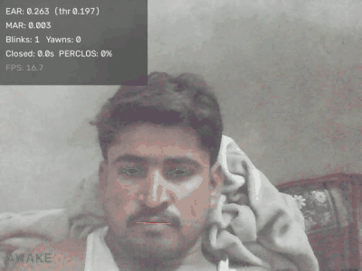

# 👁️ Real-Time Drowsiness Detection

A computer vision system that watches a driver's eyes through a webcam and raises an alarm when they start falling asleep. It runs in real time **on a normal laptop CPU, with no GPU needed**.



*Live demo: after a 2-second eye closure the alarm fires. Repeated closures then push PERCLOS above 30% and raise it again.*

## Features

- **Eye tracking** with MediaPipe Face Landmarker (478 facial landmarks, about 20–30 FPS on CPU)
- **Eye Aspect Ratio (EAR)** to measure how open the eyes are, independent of distance from the camera
- **Auto-calibration**, which learns *your* normal open-eye EAR in the first 3 seconds (people's eyes differ)
- **Two alarm rules:**
  - eyes closed continuously for *N* seconds or more (microsleep). If the face disappears while the eyes were closed (head drops forward), the alarm keeps running
  - **PERCLOS** at or above 30%, meaning the share of the last 60 s with eyes closed (a standard fatigue metric used in driver-monitoring research)
- **Blink counter** and **yawn detection** with Mouth Aspect Ratio (MAR)
- **Streamlit web app** with a live webcam, adjustable settings, live metrics, an EAR chart and a sound alarm
- **Desktop mode** with an OpenCV window and a beep alarm; it can also process a video file and save the annotated output
- **Unit-tested** decision logic (19 tests, no camera needed)

## How it works

```
Webcam frame ──► MediaPipe Face Landmarker ──► 6 landmarks per eye + 4 mouth points
                                                     │
                                   EAR = (|p2−p6| + |p3−p5|) / (2·|p1−p4|)
                                   MAR = mouth height / mouth width
                                                     │
                                   smoothing (EMA) ──► time-based state machine
                                                     │
                     blink? yawn? closed > 1.5 s? PERCLOS > 30%? ──► ALARM 🚨
```

| Eye state | Typical EAR |
|-----------|-------------|
| Open      | 0.25 – 0.35 |
| Closed    | < 0.20      |

The detector is **time-based** rather than frame-based, so a "1.5 second" rule means 1.5 seconds whether your laptop runs at 10 FPS or 30 FPS, and PERCLOS is time-weighted. For video files (`--video`) it follows the video's own timeline, not decoding speed. The alarm sound repeats while the driver stays drowsy.

## Project structure

```
drowsiness-detection/
├── app.py                 # Streamlit web app (webcam in the browser)
├── run_webcam.py          # Desktop OpenCV version + sound alarm
├── drowsiness/
│   ├── geometry.py        # EAR / MAR formulas and landmark indices
│   ├── detector.py        # Blink / yawn / PERCLOS / alarm state machine (pure Python)
│   ├── landmarks.py       # MediaPipe FaceLandmarker wrapper + model auto-download
│   └── pipeline.py        # frame → landmarks → detector → annotated frame
├── tests/                 # pytest unit tests with synthetic signals
├── models/                # face_landmarker.task is downloaded here on first run
└── requirements.txt
```

## Setup (Windows)

```bash
cd drowsiness-detection
python -m venv .venv
.venv\Scripts\activate
pip install -r requirements.txt        # add requirements-dev.txt for pytest
```

> Python 3.10–3.12 is the safest choice for MediaPipe on Windows.
> On the first run the ~3.6 MB face model downloads into `models/` automatically. If your network blocks it, download
> [face_landmarker.task](https://storage.googleapis.com/mediapipe-models/face_landmarker/face_landmarker/float16/1/face_landmarker.task)
> yourself and put it in `models/`.

## Run

**Web app**
```bash
streamlit run app.py
```
Open http://localhost:8501, click **START** and allow camera access. Keep your eyes open for 3 seconds while it calibrates, then close them for about 2 seconds to trigger the alarm.

**Desktop version**
```bash
python run_webcam.py                    # webcam (q = quit, r = recalibrate)
python run_webcam.py --video clip.mp4   # run on a recorded video
python run_webcam.py --save demo.mp4    # save annotated output for your README
python run_webcam.py --ear 0.2 --seconds 2
```

**Tests**
```bash
pip install -r requirements-dev.txt
pytest -q
```

## Settings you can tune

| Setting | Default | Meaning |
|---|---|---|
| EAR threshold | auto (75% of your open-eye EAR) | below this, eyes count as closed |
| Closed seconds | 1.5 s | continuous closure that triggers the alarm |
| PERCLOS alarm | 30% | share of the last 60 s with eyes closed |
| Yawn MAR | 0.6 | mouth opening ratio that counts as a yawn |
| Smoothing | 0.5 | EMA factor that removes landmark jitter |

## Limitations and next steps

- Sunglasses, strong backlight and extreme head angles reduce landmark accuracy.
- EAR is a hand-crafted feature. A natural upgrade is to **train a small CNN** (for example MobileNetV3) on eye crops to classify open/closed eyes, using the [MRL Eye Dataset](http://mrl.cs.vsb.cz/eyedataset), and compare it with EAR on the same test videos.
- Add **head-pose estimation** (nodding off) using the face transformation matrix from MediaPipe.
- Log sessions to CSV and plot fatigue over time.
- Deploy to Streamlit Community Cloud. For that, replace `opencv-python` with `opencv-python-headless` in `requirements.txt`, and set the `TURN_URL`, `TURN_USERNAME` and `TURN_CREDENTIAL` environment variables to a TURN relay. The default Google STUN server alone fails behind strict NATs.

## References

- Soukupová & Čech, *Real-Time Eye Blink Detection using Facial Landmarks*, CVWW 2016
- Wierwille et al., PERCLOS: *Research on vehicle-based driver status/performance monitoring*, NHTSA 1994
- [MediaPipe Face Landmarker](https://ai.google.dev/edge/mediapipe/solutions/vision/face_landmarker)

---
Built by **Kishor Kumar**, BS Artificial Intelligence, University of Sindh · [GitHub](https://github.com/2K24AI41) · [LinkedIn](https://linkedin.com/in/kishor-kumar-40a120315)
